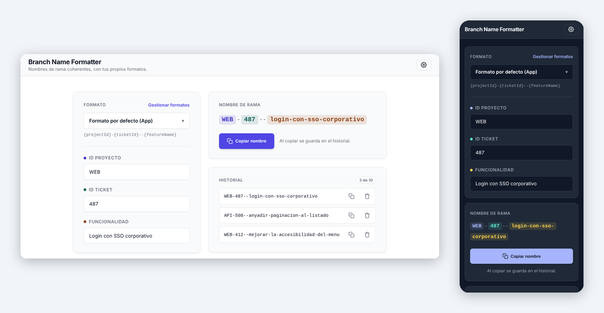

# Branch Name Formatter

*Leer esto en [Español](README-es.md).*

A fast, local-first web tool designed for developers to generate consistent Git branch names instantly.

All processing is done locally in your web browser, ensuring **complete control** of your data (Local-First). Built with **Vue 3 (Composition API)** and **TypeScript**.

**▶ [Try it: branches.jnfire.dev/](https://branches.jnfire.dev/)**



## Key Features
- **Live name:** The branch name updates as you type, with each field in its own color. Copying it also saves it to the history, and the format you chose is the one you find next time.
- **Your own formats:** Comes with three ready-to-use formats (default app format, GitFlow, Conventional Commits) and has its own section to create, clone, edit or delete yours, with a live preview, an optional example to try and a warning if the template has a typo.
- **Guaranteed Valid Names:** Sanitization (removing accents, spaces, dots, special characters, collapsing dashes...) is always applied, so every generated name is a valid git branch name. You only choose the capitalization per field (uppercase, lowercase, or as-is).
- **Language-Aware Sanitization:** Each format has a language profile (matching the app's 6 supported languages) that controls how `/` and language-specific characters (`ñ`, `ß`...) are translated into the branch name.
- **History:** Keeps your last 10 copied names for quick access (stored locally).
- **Backup:** Export your formats to a file and import them on another computer, from the Settings.
- **Local Processing:** Everything happens client-side. No server-side storage or processing of your branch data.
- **No Tracking:** No cookies, no analytics and no sign-up.
- **Interface:** Clean, professional, and responsive design with native dark/light mode support.
- **Multi-language:** Full UI support for English, Spanish, French, German, Italian, and Portuguese — including the format editor and the built-in formats themselves.

## Built With
- **Vue.js 3** (Composition API) + **Vite**
- **TypeScript** for robust, typed code.
- **Vue-i18n** for multi-language support.
- **Vanilla CSS / SCSS** for optimal performance and a professional "native" look.

## Project Architecture
The project separates business logic (`BranchManager`, `FormatManager`, `BranchFormatter`) from the view components. See [`docs/ARCHITECTURE.md`](docs/ARCHITECTURE.md) for details.

## Changelog
Notable changes per version are tracked in [`CHANGELOG.md`](CHANGELOG.md). The version number lives in `package.json` and is shown live in the app footer.

## How to Run Locally
```sh
npm install
npm run dev
```

## 📚 Documentation

- [Architecture](docs/ARCHITECTURE.md)
- [Design system](docs/DESIGN-SYSTEM.md), shared with the other portfolio tools
- [Roadmap](docs/ROADMAP.md)
- [Evolution](docs/evolution/README.md): how the project has changed, with screenshots

## 🤝 Development

Designed and directed by [Javier Nicolás Pérez Mesa](https://github.com/jnfire): the product, the architecture and the design decisions are the author's. AI has been part of the work as a deliberate experiment in learning new technology: Gemini CLI, Antigravity, GitHub Copilot and Claude Code, tried one after another. It began with small interventions and, as the experiment went on, moved towards more autonomy, always through pull requests that the author reviews. Commits made with Claude Code carry a `Co-Authored-By` trailer.

## License
Copyright (C) 2026 Javier Nicolás Pérez Mesa.

This project is free software released under the [GNU Affero General Public License v3.0](LICENSE) (`AGPL-3.0-only`). You may use, study, modify and share it. If you distribute a modified version, or offer it to users over a network, you must make its source code available under the same license.

---
Made by [Javier Nicolás Pérez Mesa](https://github.com/jnfire), 2026.
