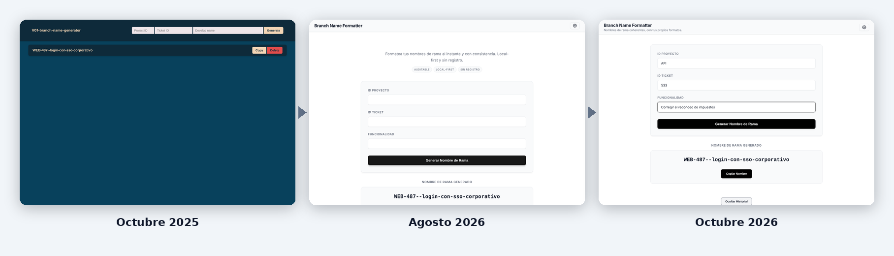

# Evolution

*Read this in [Spanish](README-es.md).*

How Branch Name Formatter went from its first commit to today, with the screenshots to show it.

## Timeline

| When | What happened |
| --- | --- |
| 2024–2025 | First commit in December 2024 (the changelog dates the initial development to April 2024). |
| October 2025 | First release (v0.1.0): a dark "branch-name-generator" with a single input row. In the same release the visual style was unified with the author's other local-first tools, and English and Spanish were added. |
| May 2026 | v0.2.0: custom language selector with flags and better keyboard accessibility. |
| August 2026 | Full redesign and a new format system: the editor for your own formats with live preview, capitalization per field, language profiles and the history. |
| October 2026 | Free software (AGPL-3.0), no Google Analytics or cookie banner, one design system shared with the other two tools, CI that gates every deploy, and the first stable release. |

## In numbers

| | Before (August 2026) | Now |
| --- | --- | --- |
| Automated tests | 63 | 80 |
| License | All rights reserved | AGPL-3.0 |
| Analytics | Google Analytics and a cookie banner | None |
| Deploy | Only if the tests pass | Only if lint, format, shared components, tests and build pass |
| Dependency advisories (npm audit) | High severity (vue-i18n) | None |

The "before" column is the state of the project on 28 August 2026, just before the round of work described above.

## Images

All the images are in this folder and in [`../screenshots`](../screenshots); they use sample data, and the map tiles are not shown because they were captured offline.

- [`branch-name-formatter-evolution-desktop.png`](branch-name-formatter-evolution-desktop.png): Three stages side by side, desktop
- [`branch-name-formatter-evolution-mobile.png`](branch-name-formatter-evolution-mobile.png): The same three stages on a phone
- [`branch-name-formatter-formats.png`](../screenshots/branch-name-formatter-formats.png): The editor for your own formats

## How it was built

Designed and directed by [Javier Nicolás Pérez Mesa](https://github.com/jnfire): the product, the architecture and the design decisions are his. Much of the implementation was written with AI assistance ([Claude Code](https://claude.com/claude-code)), working under his direction and through pull requests he reviews; the commits made that way carry a `Co-Authored-By` trailer.
